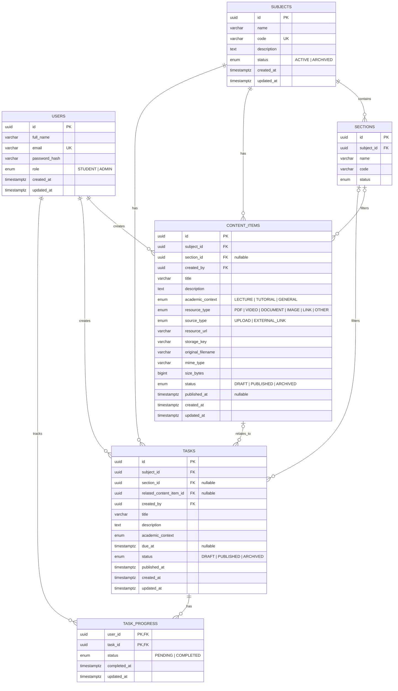

# Student Academic Hub

A central platform where students can browse subjects, access learning resources, track tasks and deadlines, and (optionally) track their own task completion. Admins manage everything through a protected dashboard, with no scripts or manual database edits.

> **Status:** Design finalized (requirements, ERD, API contract). Implementation in progress.

## Table of Contents

- [Overview](#overview)
- [Key Decisions](#key-decisions)
- [Functional Requirements](#functional-requirements)
- [Business Rules](#business-rules)
- [Database Design (ERD)](#database-design-erd)
- [Architecture](#architecture)
- [REST API Contract](#rest-api-contract)
- [Project Structure](#project-structure)
- [Build Order](#build-order)
- [Getting Started](#getting-started)
- [Open Decisions](#open-decisions)

## Overview

| Part                     | Description                                                                                                                                                  |
| ------------------------ | ------------------------------------------------------------------------------------------------------------------------------------------------------------ |
| **Student Academic Hub** | Public website to browse subjects, view their **Content** and **Tasks** tabs, and find deadlines. Logged-in students can mark tasks as Pending or Completed. |
| **Admin Dashboard**      | Protected area to manage subjects, sections, content, tasks, uploads, and publication status.                                                                |

**Tech stack:** NestJS · TypeORM · PostgreSQL · JWT authentication · Swagger (OpenAPI)

## Key Decisions

1. **Storage:** An Admin can upload files directly from the dashboard, or add External Links (e.g. Google Drive, YouTube).
2. **Organization:** Every resource is an independent `Content Item`. A lecture's PDF and its video are two separate items, even if they belong to the same lecture. There is **no Content Group** entity in the MVP.
3. **Architecture:** Modular monolith. No microservices, Redis, or message broker for this version.
4. **Sections are filters, not permissions.** Every student can access all published resources.

## Functional Requirements

| Area           | Requirements                                                                                                            |
| -------------- | ----------------------------------------------------------------------------------------------------------------------- |
| Subjects       | Browse subjects and view their Content and Tasks tabs.                                                                  |
| Content        | Each file or external link is an independent item with a title, description, type, subject, and academic context.       |
| File storage   | Admin can upload files or enter external URLs. Binary files live in file/object storage, **not** PostgreSQL.            |
| Sections       | Optional section association used for filtering, never for restricting access.                                          |
| Tasks          | Title, description, optional deadline, academic context, and optional related resource.                                 |
| Task progress  | Logged-in students can mark tasks Pending or Completed. Progress is personal.                                           |
| Authentication | Browsing is public. Student registration uses email and password. Admin operations require an authorized Admin account. |
| Publishing     | Admin can save Drafts, Publish items, or Archive them. Students see only Published items.                               |
| Responsive UI  | Student experience and admin dashboard work on mobile and desktop.                                                      |

## Business Rules

- A student does **not** need an account to browse content or tasks.
- A section is a filter, not a permission boundary.
- Every resource is independently searchable and filterable.
- Task completion is stored **per student**, not on the Task itself.
- Archiving a task must **not** delete its existing progress records.
- Public endpoints must **never** expose drafts or archived content.
- Only an Admin can create or promote an Admin account; public registration always creates a Student.

## Database Design (ERD)



### Constraints and notes

- **Users:** `email` is unique and normalized. `password_hash` only, never the raw password.
- **Sections:** unique code/name within a subject. A nullable `section_id` on content/tasks means "not tied to a section".
- **Content items:** one record = exactly one resource.
  - Uploads store `storage_key`, `original_filename`, `mime_type`, `size_bytes`.
  - External links store the URL.
  - Application validation prevents publishing an item with an invalid or missing resource.
- **Tasks:** the related content item must belong to the same subject.
- **Task progress:** composite PK `(user_id, task_id)`; `completed_at` is set on completion and cleared when marked pending again. No history table.

### Database decisions

1. PostgreSQL `UUID` primary keys and `timestamptz` timestamps.
2. Indexes on subject, publication status, section, and task deadline.
3. Use **migrations**; never automatic schema sync in production.
4. Prefer archival over deletion for published content and tasks; define foreign-key deletion behavior explicitly.
5. Files live outside PostgreSQL behind a storage service interface.
6. If sections later become many-to-many, add join tables then, not preemptively.

## Architecture

```
HTTP API (NestJS)
  Validation · Authentication guards · Role guards · Error handling
        │
  AuthModule · UsersModule · SubjectsModule · ContentModule
  TasksModule · TaskProgressModule · StorageModule
        │
  DatabaseModule  (TypeORM · PostgreSQL · Entities · Migrations)
```

| Module               | Responsibilities                                                                  |
| -------------------- | --------------------------------------------------------------------------------- |
| `AuthModule`         | Student registration, login, JWT strategy, authentication and role-based guards.  |
| `UsersModule`        | User profile and account operations.                                              |
| `SubjectsModule`     | Subject CRUD, listing, and section CRUD.                                          |
| `ContentModule`      | Content item CRUD, metadata, search/filtering, draft/publish/archive transitions. |
| `TasksModule`        | Task CRUD, deadlines, publication lifecycle, listing.                             |
| `TaskProgressModule` | Read/update the current student's task state.                                     |
| `StorageModule`      | Validate uploads, store files, return resource URLs, manage file deletion.        |
| `DatabaseModule`     | Database configuration, TypeORM integration, migrations.                          |

The Admin Dashboard is primarily a frontend area. Admin requests use the same domain modules, protected by authentication and role guards.

## REST API Contract

Base path: `/api/v1`

### Authentication

| Method | Endpoint         | Access                                                          |
| ------ | ---------------- | --------------------------------------------------------------- |
| `POST` | `/auth/register` | Public; creates a Student                                       |
| `POST` | `/auth/login`    | Public                                                          |
| `GET`  | `/auth/me`       | Authenticated                                                   |
| `POST` | `/auth/logout`   | Authenticated (if using server-managed sessions/refresh tokens) |

Access-token auth is sufficient for the first version. If refresh tokens are added, use revocable server-managed sessions with rotation.

### Subjects and sections

| Method   | Endpoint                        | Access                             |
| -------- | ------------------------------- | ---------------------------------- |
| `GET`    | `/subjects`                     | Public                             |
| `GET`    | `/subjects/:subjectId`          | Public                             |
| `POST`   | `/subjects`                     | Admin                              |
| `PATCH`  | `/subjects/:subjectId`          | Admin                              |
| `GET`    | `/subjects/:subjectId/sections` | Public                             |
| `POST`   | `/subjects/:subjectId/sections` | Admin                              |
| `PATCH`  | `/sections/:sectionId`          | Admin                              |
| `DELETE` | `/sections/:sectionId`          | Admin, subject to reference checks |

### Content items

| Method   | Endpoint                       | Access                             |
| -------- | ------------------------------ | ---------------------------------- |
| `GET`    | `/subjects/:subjectId/content` | Public; published only             |
| `GET`    | `/content/:contentId`          | Public; published only             |
| `POST`   | `/content`                     | Admin                              |
| `PATCH`  | `/content/:contentId`          | Admin                              |
| `PATCH`  | `/content/:contentId/publish`  | Admin                              |
| `PATCH`  | `/content/:contentId/archive`  | Admin                              |
| `POST`   | `/storage/uploads`             | Admin                              |
| `DELETE` | `/storage/files/:fileId`       | Admin, subject to reference checks |

Example filtering:

```
GET /subjects/:subjectId/content?sectionId=...&context=LECTURE&type=PDF&page=1&limit=20
```

**Uploads:** `POST /storage/uploads` accepts `multipart/form-data`. Validate size and allowed MIME types, generate server-controlled storage keys, and never use the original filename as a storage path.

### Tasks and personal progress

| Method  | Endpoint                     | Access                 |
| ------- | ---------------------------- | ---------------------- |
| `GET`   | `/subjects/:subjectId/tasks` | Public; published only |
| `GET`   | `/tasks/:taskId`             | Public; published only |
| `POST`  | `/tasks`                     | Admin                  |
| `PATCH` | `/tasks/:taskId`             | Admin                  |
| `PATCH` | `/tasks/:taskId/publish`     | Admin                  |
| `PATCH` | `/tasks/:taskId/archive`     | Admin                  |
| `GET`   | `/me/task-progress`          | Authenticated Student  |
| `PUT`   | `/me/task-progress/:taskId`  | Authenticated Student  |

Example progress update:

```json
{ "status": "COMPLETED" }
```

The student ID is derived from the authenticated user, never from the request body. `PUT` is idempotent: each student/task pair has one current state. The public task listing must not allow retrieving drafts or archived tasks via the `status` query parameter.

## Project Structure

```
src/
├── app.module.ts
├── main.ts
├── common/
│   ├── decorators/
│   ├── guards/
│   ├── filters/
│   └── pipes/
├── config/
├── database/
│   └── migrations/
└── modules/
    ├── auth/
    ├── users/
    ├── subjects/
    ├── sections/
    ├── content/
    ├── tasks/
    ├── task-progress/
    └── storage/
```

Each module owns its controllers, services, DTOs, entities, and tests. Shared authorization/validation utilities live in `common/`.

## Build Order

1. **Database foundation:** entities, relationships, constraints, enums, initial migrations, secure first-Admin seed.
2. **Subjects and sections:** management and public listing.
3. **Content and storage:** independent content items, external URLs, uploads, validation, publishing.
4. **Tasks:** CRUD, deadlines, related resources, publication.
5. **Authentication and progress:** student registration/login and personal task progress (anonymous browsing keeps working).
6. **Admin and student frontends:** dashboard and student views against the API contract.
7. **Quality and deployment:** unit/e2e tests, Swagger docs, Docker, CI/CD, logging, production deployment.

**Core end-to-end proof:** an Admin uploads or links a resource and publishes it under a subject; a student accesses it without logging in; a logged-in student marks a task complete without affecting anyone else's progress.

## Getting Started

> Setup instructions will be filled in as implementation progresses.

```bash
# install dependencies
npm install

# run migrations
npm run migration:run

# start in development
npm run start:dev
```

Swagger docs will be available at `/api/docs` once the API is running.

## Open Decisions

- **File storage provider:** to be chosen. It stays behind `StorageModule`, so local storage for development and object storage for production require no redesign of the content entities.
